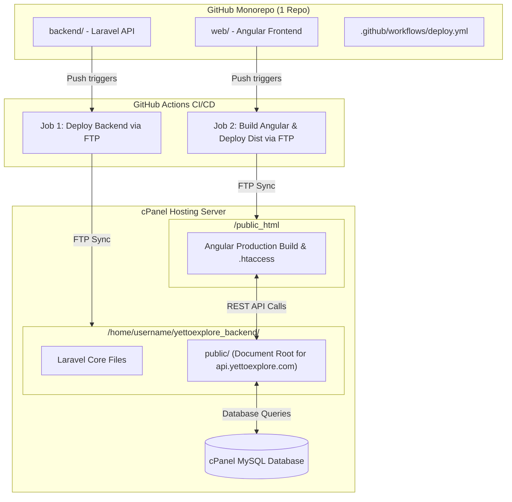

# 🚀 Complete cPanel Deployment & Automation Guide (Monorepo)

Yeh guide aapko batayegi k kese aap **1 single GitHub repository** se **Laravel Backend** (`backend/`) aur **Angular Web Frontend** (`web/`) ko **cPanel Hosting** pr automate kersaktay hain via **FTP Accounts** aur **GitHub Actions**.

---

## 📑 Table of Contents
1. [Architecture Overview](#1-architecture-overview)
2. [cPanel Domain & Directory Layout](#2-cpanel-domain--directory-layout)
3. [Step 1: cPanel me Subdomain Banayein](#step-1-cpanel-me-subdomain-banayein)
4. [Step 2: cPanel me 2 FTP Accounts Banayein](#step-2-cpanel-me-2-ftp-accounts-banayein)
5. [Step 3: cPanel me MySQL Database Banayein](#step-3-cpanel-me-mysql-database-banayein)
6. [Step 4: GitHub Repository Secrets Configure Karein](#step-4-github-repository-secrets-configure-karein)
7. [Step 5: Backend Initial Setup (First-Time Only)](#step-5-backend-initial-setup-first-time-only)
8. [Step 6: Live Deployment Test & Verification](#step-6-live-deployment-test--verification)

---

## 1. Architecture Overview



---

## 2. cPanel Domain & Directory Layout

Hosting server pr recommended secure structure:

| Component | Subdomain / URL | cPanel Directory Path | Purpose |
| :--- | :--- | :--- | :--- |
| **Laravel Backend** | `api.yettoexplore.com` | `/home/username/yettoexplore_backend/public` | REST API (`/api/v1/...`) |
| **Angular Web App** | `yettoexplore.com` (Main Domain) | `/home/username/public_html` | Travel Portal Frontend |

> **Security Note:** Laravel ke sensitive files (`app`, `config`, `.env`, `vendor`, `storage`) ko hamesha `public_html` ke bahar `/home/username/yettoexplore_backend/` me rakha jata hai, aur subdomain ka Document Root `/home/username/yettoexplore_backend/public` set hota hai.

---

## Step 1: cPanel me Subdomain Banayein

1. cPanel me login karein.
2. **Domains** -> **Create a New Domain**:
   - **Domain:** `api.yettoexplore.com`
   - **Document Root:** `yettoexplore_backend/public` (Untick "Share document root")
   - Submit karein.

---

## Step 2: cPanel me 2 FTP Accounts Banayein

cPanel me **FTP Accounts** me jayein aur 2 FTP accounts banayein:

### 1️⃣ Backend FTP Account
- **Log in:** `yte-backend` (Full username will be `yte-backend@yettoexplore.com`)
- **Password:** *Strong Password generate karein*
- **Directory:** `/yettoexplore_backend`
- **Quota:** `Unlimited`

### 2️⃣ Web Frontend FTP Account
- **Log in:** `yte-web` (Full username will be `yte-web@yettoexplore.com`)
- **Password:** *Strong Password generate karein*
- **Directory:** `/public_html`
- **Quota:** `Unlimited`

---

## Step 3: cPanel me MySQL Database Banayein

1. cPanel -> **MySQL Database Wizard**.
2. Database create karein (e.g., `username_yettoexplore`).
3. User create karein aur password set karein.
4. **ALL PRIVILEGES** assign karein.

---

## Step 4: GitHub Repository Secrets Configure Karein

GitHub repository me: **Settings** -> **Secrets and variables** -> **Actions** -> **New repository secret**:

| Secret Name | Value | Description |
| :--- | :--- | :--- |
| `FTP_SERVER` | `ftp.yettoexplore.com` ya server IP | Hosting FTP Host |
| `FTP_USERNAME_BACKEND` | `yte-backend@yettoexplore.com` | Backend FTP account |
| `FTP_PASSWORD_BACKEND` | `********` | Backend FTP password |
| `FTP_USERNAME_WEB` | `yte-web@yettoexplore.com` | Web FTP account |
| `FTP_PASSWORD_WEB` | `********` | Web FTP password |
| `FTP_PORT` *(Optional)* | `21` | FTP Port (Default: 21) |

---

## Step 5: Backend Initial Setup (First-Time Only)

cPanel File Manager ya Terminal me ja ker `/yettoexplore_backend/`:
1. `.env` file create karein (`.env.example` copy karein).
2. Database credentials configure karein:
   ```env
   APP_ENV=production
   APP_DEBUG=false
   APP_URL=https://api.yettoexplore.com

   DB_CONNECTION=mysql
   DB_HOST=127.0.0.1
   DB_PORT=3306
   DB_DATABASE=username_yettoexplore
   DB_USERNAME=username_dbuser
   DB_PASSWORD=your_db_password
   ```
3. Run migrations & storage symlink:
   ```bash
   php artisan key:generate
   php artisan migrate --force
   php artisan storage:link
   ```

---

## Step 6: Live Deployment Test & Verification

Jab bhi aap `main` ya `master` branch pr code push karenge:
- Agar `backend/**` me change hoga to sirf Laravel Backend FTP sync hoga.
- Agar `web/**` me change hoga to Angular app automatically Node 22 pr build ho ker `dist/yettoexplore/browser` se FTP sync hogi.
- GitHub Actions tab me ja ker aap manual deployment (`workflow_dispatch`) bhi trigger kar saktay hain (`all`, `backend`, ya `web`).
